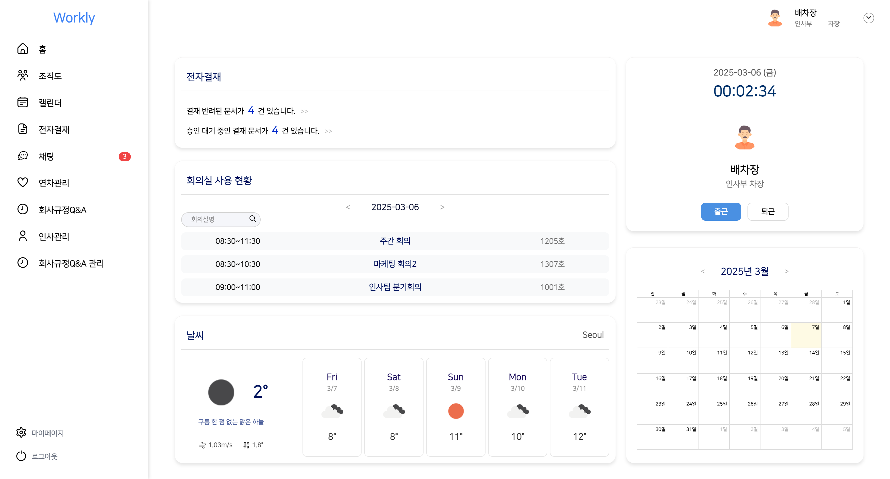
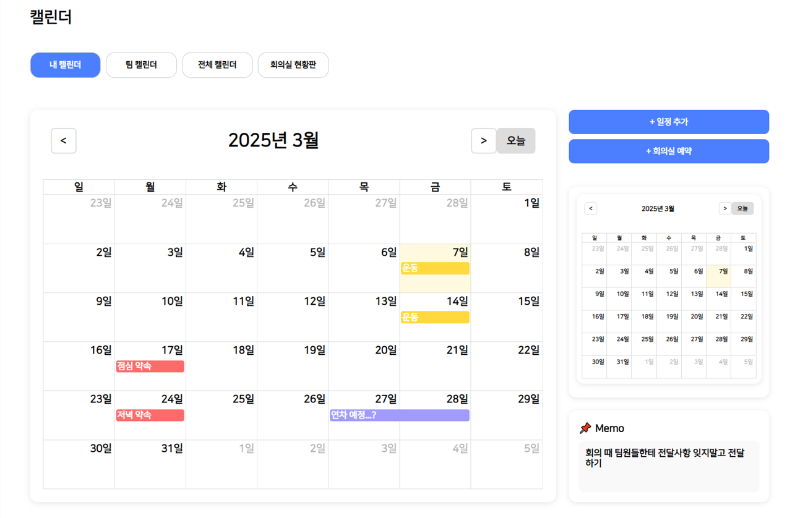
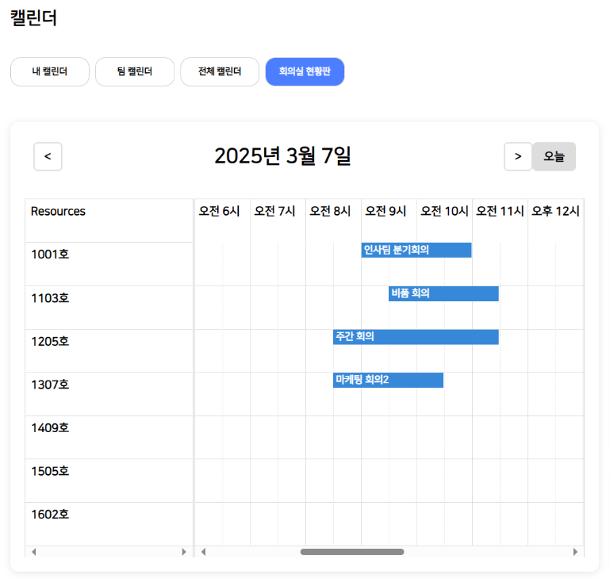
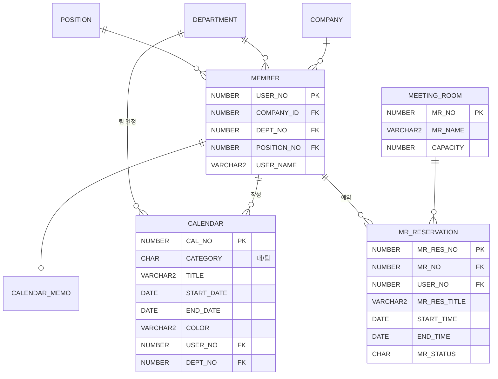

# 🏢 Workly — 사내 그룹웨어

> 전자결재, 근태·연차, 일정·회의실 예약, 실시간 채팅, AI 사내 규정 Q&A를 하나로 묶은 웹 그룹웨어입니다.
> 회사(`companyId`)마다 데이터를 나눠서, 여러 회사가 함께 쓸 수 있게 설계했습니다.



| 항목 | 내용 |
|---|---|
| 기간 | 2025.01.26 ~ 2025.03.07 (기획 → 설계 → 구현 → 발표) |
| 인원 | 팀 프로젝트 6명 |
| 내 역할 | **캘린더 · 회의실 예약 · 조직도**, 메인페이지 회의실 위젯 (React 화면 + Spring API + MyBatis SQL) |
| 내 커밋 | 45개 |

<br>

## 🛠 기술 스택

| 구분 | 사용 기술 |
|---|---|
| Backend | Java 17, Spring Boot 3.4, Spring Security + JWT, MyBatis, WebSocket(STOMP), Spring Mail, Apache POI |
| Frontend | React 18, TypeScript, Vite, Redux Toolkit, React Router, MUI, **FullCalendar**, Axios |
| Database | Oracle |
| AI | LangChain + OpenAI API (사내 규정 Q&A) |
| Infra (팀) | Docker, Jenkins, AWS EC2 · RDS |
| Tool | STS4, VS Code, SQL Developer, Git/GitHub |

<br>

## 📌 전체 기능

- **인증**: JWT 로그인, 회사 등록, 비밀번호 변경
- **전자결재**: 문서 작성, 결재선 지정, 승인·반려, 임시저장, 참조, 알림
- **근태·연차**: 출퇴근 기록, 연차 신청·관리, 연차 정책 설정
- **인사관리**: 사원 등록·검색·수정, 부서·직급 관리, 급여 엑셀 저장
- **채팅**: WebSocket 기반 1:1·그룹 채팅, 즐겨찾기
- **AI 사내 규정 Q&A**: 회사별 규정을 등록하고 질문하면 답변
- **캘린더·회의실 / 조직도**: 아래 "내가 구현한 기능"

<br>

## 🙋‍♂️ 내가 구현한 기능

### 1. 캘린더
- **내 캘린더 / 팀 캘린더 / 전체 캘린더 / 회의실 현황판**을 탭으로 전환
  - 팀 캘린더는 부서(`deptNo`) 단위로 일정을 공유하고, 전체 캘린더에는 회의실 예약을 표시
- 일정 **추가·수정·삭제 모달**: 카테고리(내/팀)별 색상으로 등록
- **미니 캘린더**: 메인 캘린더와 별개로 다른 연·월 조회
- **개인 메모**: 입력란에서 포커스가 벗어나면(`onBlur`) 자동 저장



### 2. 회의실 예약
- 예약 추가·수정·삭제, **같은 회의실·같은 시간대 중복 예약 차단** (아래 트러블슈팅)
- **회의실 현황판**: FullCalendar resource-timeline으로 회의실(호수)별 시간표 표시
- **메인페이지 위젯**: 날짜를 넘기며 시간별 회의실 사용 현황 확인, 회의실명 검색



### 3. 조직도
- 로그인한 사용자의 `companyId`로 **자기 회사 사원만** 조회
- 부서 번호 오름차순 → 같은 부서 안에서는 직급 순으로 정렬
- 이름 검색, 행 클릭 시 사원 상세정보 모달

### API (Spring Boot)

| Method | URL | 설명 |
|---|---|---|
| GET | `/schedule/user/{userNo}` | 내 일정 조회 |
| GET | `/schedule/team/{deptNo}` | 팀(부서) 일정 조회 |
| POST / PUT / DELETE | `/schedule/add`, `/schedule/update/{id}`, `/schedule/delete/{id}` | 일정 등록·수정·삭제 |
| GET / POST / PUT | `/memo/{userNo}`, `/memo/add`, `/memo/update/{userNo}` | 개인 메모 |
| - | 회의실 / 회의실 예약 API | 예약 등록 시 중복 검사 |

<br>

## 🔥 트러블슈팅

### 1. 여러 날 일정이 하루 짧게 표시되는 문제
- **문제**: 3/7~3/8로 등록한 일정이 캘린더에는 3/7까지만 표시됨
- **원인**: FullCalendar는 종료일을 **포함하지 않는(exclusive)** 값으로 처리
- **해결**: 시작일과 종료일이 다르면 저장 전에 종료일에 하루를 더해서 FullCalendar 기준에 맞춤

```tsx
// components/calendar/Modal.tsx
let adjustedEndDate = new Date(endDate);
if (new Date(startDate).getTime() !== new Date(endDate).getTime()) {
  adjustedEndDate.setDate(adjustedEndDate.getDate() + 1);
}
```

### 2. 회의실 중복 예약
- **문제**: 같은 회의실을 같은 시간대에 여러 명이 예약할 수 있었음
- **해결**: 예약 전에 같은 회의실(`MR_NO`)에서 **시간이 겹치는 예약**을 조회하고, 있으면 예외를 던져 등록을 막음. 화면에는 중복 예약 알림 모달을 띄움.
  - 겹침 조건: `새 시작 < 기존 종료 AND 새 종료 > 기존 시작`
  - 예약을 **수정**할 때는 자기 자신의 예약을 비교 대상에서 빼야 함 → `removeIf`로 현재 예약 제외

```xml
<select id="getOverlappingReservations" resultType="MeetingReservation">
  SELECT * FROM MR_RESERVATION
   WHERE MR_NO = #{mrNo} AND MR_STATUS = 'N'
     AND (#{startTime} &lt; END_TIME AND #{endTime} &gt; START_TIME)
</select>
```

```java
List<MeetingReservation> overlapping =
    meetingReservationDao.getOverlappingReservations(reservation.getMrNo(), newStart, newEnd);
if (!overlapping.isEmpty()) {
    throw new IllegalArgumentException("해당 시간대의 회의실은 이미 예약 되어있습니다.");
}
```

<br>

## 🗂 ERD (내 담당 영역)

전체 32개 테이블 중 캘린더·회의실·조직도 관련 테이블입니다.



<br>

## ▶ 실행 방법

```bash
# backend
cd backend/final-project
cp src/main/resources/application-example.properties src/main/resources/application.properties
# application.properties에 DB 계정, JWT 키, 메일 계정을 채운 뒤
./mvnw spring-boot:run

# frontend
cd frontend/react-practice-ts
npm install
# .env 에 VITE_OPENAI_API_KEY, VITE_WEATHER_KEY 설정
npm run dev
```

> 실제 접속 정보가 들어 있던 설정 파일과 사용자 업로드 이미지는 저장소 기록에서 제거했습니다.

<br>

## 📝 회고

- 6명이 브랜치를 나눠 작업하고 PR로 합치면서 충돌을 해결하는 협업 흐름을 익혔습니다.
- 라이브러리(FullCalendar)의 날짜 처리 규칙처럼 "문서를 읽어야 보이는" 동작을 직접 겪고 해결했습니다.
- 아쉬운 점: 프론트에서 API 주소(`http://localhost:8003`)를 컴포넌트마다 직접 적었습니다. 다시 만든다면 `VITE_API_URL` 환경변수와 공통 Axios 인스턴스로 분리하겠습니다.
